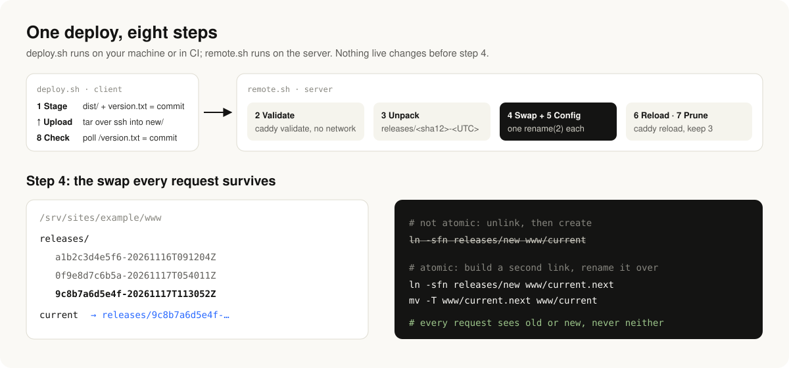

# deploy-kit

Deploy a static site to your own server **without dropping open connections**: three bash scripts, release directories, one atomic symlink rename, a validated Caddy config, a graceful `caddy reload` and a health check.

[](https://github.com/wonmortech/deploy-kit/actions/workflows/ci.yml)
[](https://scorecard.dev/viewer/?uri=github.com/wonmortech/deploy-kit)


**[Website](https://wonmor.io) · [Post: Zero-downtime static deploys with Caddy](https://wonmor.io/engineering/zero-downtime-static-deploys/) · [Changelog](CHANGELOG.md) · [Tags](https://github.com/wonmortech/deploy-kit/tags)**



## What it does

- **Release directories.** Every deploy unpacks into `www/releases/<sha12>-<UTC time>`; a live release is never modified.
- **Atomic swap.** A second symlink is renamed over `www/current` with one `rename(2)`, so every request sees the old release or the new one.
- **Validated config.** `caddy validate` runs in a throwaway container with `--network none` before anything live changes.
- **Graceful reload.** `caddy reload` applies the config in place; open downloads keep their file descriptors and finish.
- **Health check.** `deploy.sh` polls `/version.txt` on the public URL until it returns the new commit hash.
- **Rollback in one command.** `rollback.sh` uses the same rename and reload, so it is zero-downtime too.
- **Tested without a server.** `tests/run.sh` stubs `docker`, `ssh`, `curl` and `date`; CI runs it with ShellCheck on every pull request.

It is a generalised version of the deploy flow in the [post](https://wonmor.io/engineering/zero-downtime-static-deploys/). All hosts, paths and names here are placeholders: `example.com`, `deploy@your-server`, `/srv/sites/example`.

```
deploy/
  deploy.sh           runs on your machine or in CI: stage, upload, call remote.sh, health check
  remote.sh           runs on the server: validate, unpack, swap, reload, prune
  rollback.sh         runs on the server: point current at an earlier release and reload
  Caddyfile           serves /www/current
  docker-compose.yml  one caddy:2-alpine container
tests/run.sh          tests for the three scripts (docker, ssh, curl stubbed; no server needed)
.github/workflows/deploy.yml   example manual-dispatch workflow
```

## Quick start

```bash
# 1. copy deploy/ into your site's repository and adjust the Caddyfile
# 2. build your site into dist/
npm run build
# 3. deploy the current commit (it must be pushed to origin/main)
SITE_URL=https://example.com REMOTE_DIR=/srv/sites/example deploy/deploy.sh deploy@your-server
```

The first deploy creates the layout on the server and starts the container. Point your reverse proxy (or DNS, if this Caddy terminates TLS itself; see the comment at the top of the Caddyfile) at it.

**Requirements.** Server: Linux with Docker and the Compose plugin, a user that can run `docker` and write to `/srv/sites/example`, SSH access. Client: `bash`, `git`, `ssh`, `tar`, `curl`. The site must be committed in git; `deploy.sh` deploys the current commit only.

## How it works

Server layout under `/srv/sites/example`:

```
conf/Caddyfile        mounted as a directory: conf/ -> /etc/caddy
www/releases/<rel>/   one directory per deploy, never modified afterwards
www/current           symlink -> releases/<rel>; Caddy's root is /www/current
www/history           kept release names, oldest first, last = live
docker-compose.yml    the web container
REVISION              commit hash of the live release
```

| Step | What happens | Why |
|---|---|---|
| 1. Stage | `deploy.sh` copies `dist/` and writes the commit hash to `version.txt` inside it | The health check needs a value that is unique to this deploy |
| 2. Validate | `remote.sh` runs `caddy validate` on the new Caddyfile in a throwaway container with `--network none` | A broken config stops the deploy before anything live changes |
| 3. Unpack | The site moves to `www/releases/<sha12>-<UTC time>` | No request has ever seen this directory; the timestamp means redeploying the same commit never overwrites the live release |
| 4. Swap | `ln -sfn releases/<rel> www/current.next && mv -T www/current.next www/current` | `ln -sfn` alone is unlink-then-create; renaming a second link over the first is a single `rename(2)` |
| 5. Config | `conf/Caddyfile.next` is renamed over `conf/Caddyfile` | A single-file bind mount pins the old inode; mounting the directory lets the container see the renamed file |
| 6. Reload | `docker compose up -d` (a no-op unless the compose file changed), then `caddy reload` | Reload applies the config in place. Open downloads keep their file descriptors on the old release and finish normally |
| 7. Prune | Only the last `KEEP_RELEASES` (default 3) releases are kept | Old releases stay long enough for slow downloads and for rollback |
| 8. Health check | `deploy.sh` polls `https://example.com/version.txt` until it returns the new commit hash | Proves the public URL serves the new release, through any proxy in front of it |

**The setting deliberately left out.** Caddy's `grace_period` limits how long the server waits for open connections on shutdown, but Caddy also applies it on config reloads, so any value would force-close slow downloads during an ordinary deploy. It is left unset. The bound on shutdown time is Docker's `stop_grace_period: 15s`, which only matters when the container is actually recreated (when `docker-compose.yml` changes).

## Rollback

On the server:

```bash
cd /srv/sites/example
./rollback.sh --list          # kept releases, live one marked with *
./rollback.sh                 # back to the previous release
./rollback.sh <release-name>  # to a specific kept release
```

If the health check fails, `deploy.sh` exits non-zero and prints the rollback command; it does not roll back on its own.

## GitHub Actions

[`.github/workflows/deploy.yml`](.github/workflows/deploy.yml) is an example that runs on manual dispatch only. It builds the site, installs an SSH key and a pinned `known_hosts` from repository secrets, and calls `deploy/deploy.sh`.

| Name | Kind | Example |
|---|---|---|
| `DEPLOY_SSH_KEY` | secret | private key of the deploy user |
| `DEPLOY_KNOWN_HOSTS` | secret | output of `ssh-keyscan your-server` |
| `DEPLOY_TARGET` | variable | `deploy@your-server` |
| `SITE_URL` | variable | `https://example.com` |

Keep `dist/` in `.gitignore`: `deploy.sh` refuses to deploy from a working tree with uncommitted changes.

## Limitations

- **Mixed versions within one page load.** If the swap lands between the HTML request and an asset request, a page can get HTML from the old release and CSS from the new one. Content-hashed asset names reduce the effect.
- **Rollback is a command.** Nothing switches back automatically after a failed health check.
- **The health check is one URL.** It proves the release is served, not that every page works.
- **A recreate still has a limit.** When `docker-compose.yml` changes, open downloads get `stop_grace_period` (15 s), not unlimited time.
- **`mv -T` is GNU coreutils.** The server must be Linux (the client side does not need it).

## Development

```bash
shellcheck --severity=style deploy/*.sh tests/*.sh
bash tests/run.sh      # on Linux: the swap tests need real symlinks and GNU mv
```

CI runs both on every pull request. See [CONTRIBUTING.md](CONTRIBUTING.md) for the rules and [SECURITY.md](SECURITY.md) to report a vulnerability privately. Changes are listed in [CHANGELOG.md](CHANGELOG.md).

## Licence

[MIT](LICENSE).
